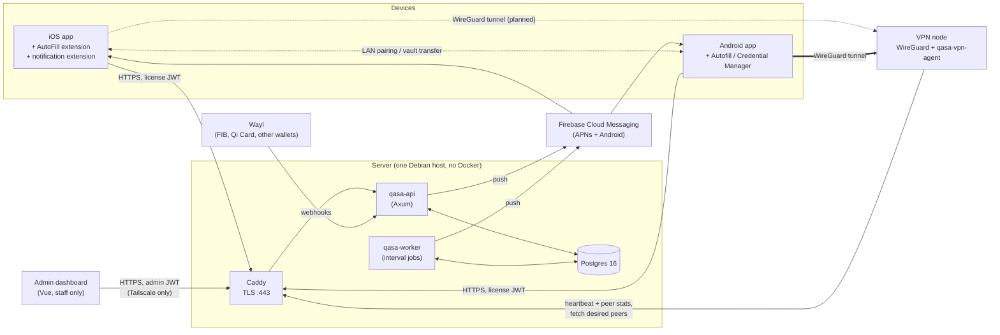

# Qasa architecture

Qasa is a local-first password manager for iOS and Android, sold with Premium extras
(more devices, VPN, Wi‑Fi device sync) for 5,000 IQD a month or 50,000 IQD a year, and paid for through Wayl
(FIB, Qi Card and other Iraqi wallets). This document describes the whole system as it is in the code today: the Rust
API and its worker, the node agent that runs on VPN servers, the two mobile apps and their
extensions, the admin dashboard, and the shared localization.

Work that is still open is tracked in [`docs/server-followups-plan.md`](docs/server-followups-plan.md).
Design rules for the apps are in [`docs/design.md`](docs/design.md), and user-facing flows
in [`docs/application-flow.md`](docs/application-flow.md).

---

## 1. The one rule: the vault never leaves the device

Every password, card and note is encrypted on the phone with keys derived from the
master password, and stored on the phone. The server never receives vault content, the
master password, or anything derived from it.

The vault leaves the device in only two ways, both under the user's control and both still
encrypted: Wi‑Fi sync to the user's own devices (section 9.2), and backup files the user
saves where they choose (section 9.5). Neither passes through the server.

The server knows only what it needs to sell and meter features:

| The server stores | The server never sees |
| --- | --- |
| A random account id the app generated | The master password, keys, or vault items |
| Devices: name, platform, a coarse location hint, push token, locale | Email addresses (breach monitoring sends only a SHA-256 hash) |
| Subscriptions and payments | What the user searches for (search is a client-side blind index) |
| VPN sessions: node, assigned address, handshake time, byte counts | VPN traffic contents |
| Inbox notifications and read state | |

Consequences that show up everywhere below:

- **There is no login.** An account *is* a random UUID created on first launch. A
  device proves it belongs to the account with a license token the server signs.
- **Adding a device is pairing,** not signing in: the new device adopts the account id
  from an existing one (section 9.2).
- **Losing every device loses the vault, unless the user kept a backup file** (section
  9.5). There is no server-side recovery (todo `account-recovery` covers the rest).

---

## 2. Repository layout

One repository for everything. Each part keeps its own native tooling: there is no
monorepo build system.

```
qasa/
├── server/                Rust workspace: API, worker, VPN node agent, breach CLI
│   ├── crates/            qasa-api, qasa-core, qasa-db, qasa-payments, qasa-push,
│   │                      qasa-breach, qasa-vpn, qasa-worker
│   ├── migrations/        Postgres schema (sqlx, applied on start)
│   ├── deploy/            production: Debian setup, systemd units, Caddyfile, deploy
│   └── scripts/           integration tests, API smoke test
├── core/                  Rust workspace shared by the clients
│   ├── qasa-vault/        crypto, payload shapes, search, CSV, golden vectors
│   ├── qasa-sync/         Wi‑Fi sync: PAKE pairing, channel, merge
│   ├── qasa-backup/       encrypted backup files (section 9.5)
│   └── qasa-ffi/          UniFFI bindings of the above for iOS and Android
├── apps/
│   ├── ios/               Xcode project: app + AutoFill and notification extensions
│   ├── android/           Gradle project: Kotlin, Jetpack Compose
│   ├── desktop/           Tauri 2 desktop app (Rust core + Vue)
│   ├── extension/         browser extension (talks only to the desktop app)
│   ├── landing/           qasa-app.com (Astro), including the privacy policy
│   └── dashboard/         Vue 3 admin console (Vite, bun)
├── l10n/                  One string table → iOS and Android catalogs
├── docs/                  Plans, design system, flows
├── Makefile               Local dev shortcuts
└── ARCHITECTURE.md        This file
```

| Part | Language / stack | Build | Tests |
| --- | --- | --- | --- |
| `server/` | Rust 1.82+, Axum 0.8, sqlx 0.8, Postgres 16 | `cargo build` | `cargo test` (unit); `server/scripts/test-integration.sh` (DB + HTTP router) |
| `apps/ios/` | Swift, SwiftUI, SwiftData | Xcode / `xcodebuild -scheme qasa` | none yet |
| `apps/android/` | Kotlin 2.1, Compose, Hilt, Room; min SDK 26, target 35 | `./gradlew :app:assembleDebug` | `./gradlew :app:testDebugUnitTest` |
| `apps/dashboard/` | Vue 3.5, TypeScript, Vite 8, Tailwind 4, shadcn-vue | `bun run build` | type check in build |
| `core/` | Rust 1.82+ | `cargo build` | `cargo test` |
| `l10n/` | Python 3 | `python3 l10n/generate.py` | `generate.py --check` |

---

## 3. System overview



- **Control plane vs data plane.** The API decides who may connect where. VPN traffic
  never passes through it: it goes from the device to a WireGuard node, and the node's
  agent keeps the WireGuard peer list in line with the API.
- **Everything client-facing goes through Caddy,** which terminates TLS. The API
  publishes no port of its own in production.

---

## 4. Server

### 4.1 Crates

The dependency graph is one-way: `qasa-api` and `qasa-worker` sit on top; `qasa-core`
knows nothing about HTTP or SQL.

| Crate | Kind | Responsibility |
| --- | --- | --- |
| `qasa-api` | binary | HTTP router, auth extractors, request limits, handlers. Router tests in `src/router_tests.rs` |
| `qasa-core` | library | Config, tiers and entitlements, Ed25519 license tokens, admin tokens, Argon2 password hashing |
| `qasa-db` | library | Connection pool, migrations, one module per table group under `src/repos/`, integration tests under `tests/` |
| `qasa-payments` | library | `PaymentGateway` trait (checkout, webhook, status lookup, saved-method charge), the `Gateways` registry the API and worker share, the Wayl gateway, the three wallet stubs; renewal timing constants |
| `qasa-push` | library | FCM HTTP v1 delivery, per-device locale, dead-token cleanup |
| `qasa-breach` | library + CLI | Hash/prefix handling; `qasa-breach ingest` loads breach hashes |
| `qasa-vpn` | library + binary | WireGuard config types, key checks, IP pool, `wg` dump parsing and sync planning; the `qasa-vpn-agent` binary |
| `qasa-worker` | binary | Interval jobs (section 4.7) |

### 4.2 A request's path

```
Caddy (TLS, real client IP in X-Forwarded-For)
  → CORS (exposes X-Next-Before for paging)
  → admin network guard: /v1/admin/* only from QASA_ADMIN_ALLOW_CIDRS (Tailscale)
  → handler
      → extractor: LicenseAuth | AdminAuth | AdminWrite (section 4.3)
      → request limit check, where the route has one (section 4.10)
      → repo calls (qasa-db); multi-step changes run in one transaction
  → JSON response; errors map to {"error": code, "message"?} with a fitting status
```

The client IP is taken from `X-Forwarded-For` only when the TCP peer is in
`QASA_TRUSTED_PROXY_CIDRS` (the Caddy network); otherwise the peer address is used.

### 4.3 Identity and auth

| Who | Token | How it is checked |
| --- | --- | --- |
| A device | **License token**: Ed25519-signed JWT, 30 days. Claims: account id, device id, `jti`, tier, entitlements, `device_limit`, `breach_monitor_limit` | Signature, then the database: the device must still be linked, the account neither blocked nor deleted, the token issued after the device's last unlink, and its `jti` not revoked (`device::is_license_live`) |
| Staff | **Admin token**: HS256 JWT, 8 hours | Signature, then the database: the admin must exist, not be disabled, and not have logged this token out. The role is re-read on every request |
| A VPN node agent | Per-node agent token (random 256 bits, stored hashed) in `x-qasa-agent-token` | Constant-time compare with the stored hash |
| A payment gateway | Webhook signature (real gateways); stubs only settle in dev | `PaymentGateway::verify_webhook` |

- **Admin roles.** `admin` can change things. `viewer` reads only: every mutating admin
  route uses the `AdminWrite` extractor and returns 403 to viewers. Admins are managed with
  SQL.
- **Getting a license.** `POST /v1/devices/register` is unauthenticated by design: it takes
  the account id, a stable device fingerprint, a name and a platform, and returns a license
  token. Clients verify tokens offline with the public key from
  `/.well-known/qasa-license-key`.

### 4.4 Tiers and entitlements

Premium comes **only** from a live subscription row (`active` or `cancelled`, not yet
expired). The `accounts.tier` column is a cache, and a stale `premium` there grants
nothing.

| | Free | Premium |
| --- | --- | --- |
| Linked devices | 1 | 5 |
| 2FA codes for saved logins (on device) | yes | yes |
| Breached-password check (on device, section 4.11) | no | yes |
| Email leak alerts | parked | parked (entitlement still issued: 10 email hashes) |
| VPN | no | yes, monthly data quota from the plan (100 GB default), then 5 Mbps |

- **When Premium lapses,** the account falls back to Free. Devices stay linked, but only
  the oldest (the primary) keeps getting licenses; the others get `device_limit_exceeded`
  until the user frees a slot or pays again. The worker labels such accounts `expired` for
  the dashboard.
- **Staff grants.** Premium granted by staff is an ordinary subscription row worth 0 IQD,
  with `granted_by`, `grant_days` and `grant_reason` set. Every rule above applies to it
  unchanged.

### 4.5 Data model

Migrations live in `server/migrations/` and are applied by `sqlx::migrate!` when the API
or the worker starts. The main tables:

| Area | Tables | Notes |
| --- | --- | --- |
| Accounts | `accounts` | `tier` (cache), `blocked_at`, `deleted_at` (a tombstone: a deleted id can never register again) |
| Devices | `devices`, `license_revocations` | `UNIQUE(account_id, fingerprint)`; `revoked_at` = unlinked; `tokens_valid_after` kills older tokens; `push_token`, `locale`, `notifications_enabled`; `restore_key_hash` and `restore_key_prev_hash` (section 9.5), cleared on unlink |
| Billing | `plans`, `subscriptions`, `payments`, `payment_methods`, `webhook_events` | Price comes from `plans`. A payment is a `checkout` or a `renewal` and moves from `pending` to `success`, `failed` or `expired` (abandoned). `payment_methods` holds at most one live gateway token per account, for renewals. Webhook events record the verified status, amount and token |
| Breach | `breach_hashes`, `monitored_email_hashes` | Breach data keyed by 5-hex prefix; monitors are full SHA-256 hashes of emails |
| VPN | `vpn_nodes`, `vpn_sessions`, `vpn_usage` | Unique indexes on live sessions per device, per (node, address) and per (node, key). `last_handshake_at` comes from the node |
| Inbox | `notifications`, `notification_receipts` | One receipt per account per notification, carrying `read_at`, `pushed_at` and `deleted_at` (per-user delete) |
| Staff | `admin_users`, `admin_token_revocations`, `admin_audit_log` | Every admin change is written to the audit log |
| Limits | `rate_limit_buckets` | UNLOGGED, fixed windows, shared by every API process |

### 4.6 API surface

The complete endpoint table is in [`server/README.md`](server/README.md#phase-1-endpoints),
and `server/crates/qasa-api/src/main.rs` is authoritative. By area:

| Area | Endpoints (prefix `/v1`) | Auth |
| --- | --- | --- |
| Devices and license | `devices/register`, `devices/link-check`, `devices`, `devices/{id}`, `devices/me`, `devices/me/restore-key`, `devices/others`, `devices/prefs`, `license` | none for register/link-check; license otherwise |
| Account | `DELETE account` (with `confirm_account_id`) | license |
| Plans and billing | `pricing`, `subscription`, `subscription/auto-renew`, `subscription/cancel`, `DELETE payment-method`, `payments`, `payments/intents`, `payments/{id}`, `payments/webhook/{fib,fastpay,superqi,wayl}` | none for pricing/webhooks; license otherwise |
| Breach | `breach/prefix/{prefix}`, `breach/monitor` (+ `/{id}`) | license; Premium to look up or register |
| VPN | `vpn/nodes`, `vpn/connect`, `vpn/disconnect`, `vpn/status` | license; Premium to connect |
| Inbox | `notifications`, `notifications/unread-count`, `notifications/read-all`, `notifications/{id}`, `notifications/{id}/read` | license |
| VPN agent | `internal/vpn/nodes/{id}/heartbeat`, `internal/vpn/nodes/{id}/peers` | agent token |
| Admin | `admin/auth/*`, `admin/overview`, `admin/analytics`, `admin/timeseries`, `admin/users`, `admin/accounts/{id}` (+ block, devices, grants), `admin/grants`, `admin/payments` (+ `/{id}`), `admin/webhooks`, `admin/cancellations`, `admin/plans`, `admin/notifications`, `admin/vpn/nodes` (+ edit, retire, agent-token), `admin/licenses/revocations`, `admin/audit`, `admin/telemetry` | admin token; writes need role `admin` |

Paging is cursor-based everywhere: `?limit=&before=<timestamp>`, with `next_before` in the
response. The admin users list keeps a bare-array body and returns its cursor in the
`X-Next-Before` header.

### 4.7 Worker jobs

`qasa-worker` runs in production (or with `QASA_WORKER_ENABLE=1`). Each job is a
`tokio` interval loop; a failed run is logged, and the next run is the retry.

| Job | Every | What it does |
| --- | --- | --- |
| `expire_subscriptions` | 15 min | Expire ended subscriptions, mark accounts lapsed, end VPN sessions of non-subscribers |
| `expire_abandoned_payments` | 5 min | `pending` checkouts older than 60 min, and renewal links past their `pay_by`, become `expired` (a late confirmation still settles) |
| `check_open_payments` | 5 min | Ask Wayl about open (or abandoned in the last day) payments not checked in 10 min, and settle what it reports, in case a webhook was missed |
| `broadcast_pushes` | 1 min | Push admin broadcasts to each device in its language, once per receipt, for up to 24 h |
| `webhook_retry` | 1 min | Re-settle verified webhook events still pending, through the same settlement code as the API |
| `offline_vpn_nodes` | 1 min | Nodes with no heartbeat for 2 min go `offline` |
| `stale_vpn_sessions` | 1 min | End sessions with no handshake for 5 min (or none within 10 min of connecting) |
| `breach_alert_scan` | not scheduled | Parked with email leak alerts. Would match monitored hashes against breach data and push Premium accounts (at most weekly per hash) |
| `subscription_expiry_warnings` | 1 h | First sends renewal links: a payment link for the next period to auto-renew subscriptions ending within 4 days that nothing can charge (section 4.8). Then the "Premium ends in 3 days" push, only to subscriptions that will not renew by themselves and got no link |
| `charge_renewals` | 15 min | Charge saved methods for auto-renew subscriptions ending within 24 h (section 4.8) |
| `subscription_renew_failed_notices` | 1 h | "We couldn't renew" push, once, after the worker's attempts are used up or the saved method was rejected |
| `purge_license_revocations` | 1 day | Drop expired token revocations, admin and device |
| `purge_rate_limit_buckets` | 5 min | Drop rate-limit windows older than a day |

### 4.8 Payments

1. **Intent.** The app calls `POST /payments/intents` with a gateway and a plan. The
   amount comes from `plans`; an `amount_iqd` that doesn't match is refused, and an
   `idempotency_key` makes retries safe. The server creates the gateway order and
   returns a deep link: to the wallet app, or, through Wayl, to Wayl's hosted page.
   `Gateways::for_checkout` decides which gateway takes it: Wayl takes every checkout
   once it is configured (its page offers the same wallets), otherwise the wallet picked.
2. **Pay.** The user pays in the wallet app or on Wayl's page. The app polls
   `GET /payments/{id}`.
3. **Settle.** The gateway's webhook is verified, recorded in `webhook_events`, and passed
   to **`settle_payment`** (`qasa-db/src/repos/settlement.rs`), the only code path that
   turns money into an entitlement. In one transaction, with the payment row locked, it
   checks the gateway and the amount, then grants the subscription and marks the payment
   paid. Time stacks: paying early extends from the current end date. The worker's retry
   and status-check jobs use the same function.
4. **Refresh.** The app sees `success` and refreshes its license, which now carries
   Premium.

**Automatic renewals.**

- **Consent and the saved method.** A checkout paid with `auto_renew` on asks the gateway
  to save the wallet (`create_intent(…, save_method)`). The token arrives with the
  successful webhook, and `settle_payment_with_token` stores it in `payment_methods` in the
  same transaction as the grant, but only if the payment had auto-renew on. A newer
  consented checkout replaces it. `DELETE /v1/payment-method` forgets it; deleting the
  account does too.
- **Will it renew?** `GET /v1/subscription` reports `renewal.mode`, which is what the
  apps show under the toggle:
  - `charge` when auto-renew is on, a live method exists, and its gateway
    `supports_recurring()` (`will_renew` true).
  - `link` when auto-renew is on but nothing can charge it and a gateway can send renewal
    links (Wayl). `renewal.link` is the open link once it is out.
  - `none` otherwise: it lapses at its end date and gets the 3-day reminder.
  `GET /v1/pricing` says the same per wallet (`auto_renew`), so the checkout screen's
  consent text matches what will happen.
- **Charging.** `charge_renewals` picks subscriptions ending within
  `RENEWAL_LEAD_HOURS` (24). It counts the attempt first (`renewal::claim_attempt`, a
  compare-and-swap, so two runs cannot both charge), inserts a `renewal` payment at the
  plan's current price, then calls `charge_saved` with the payment id as the reference. A
  synchronous answer goes straight to `settle_payment`; a pending one waits for the webhook
  like a checkout. Paid time stacks onto the old end, and the new period keeps auto-renew.
- **Failures.** A decline is retried after `RENEWAL_RETRY_HOURS` (6), up to
  `RENEWAL_MAX_ATTEMPTS` (3), all before the end date. A rejected token is dropped at once.
  Either way the customer gets one `SUB_RENEW_FAILED` push and pays by hand; turning
  auto-renew off and on again starts a fresh round. An inactive plan is not renewed.
- **Renewal links.** Wayl cannot charge a saved wallet at all, so where nothing can,
  `send_renewal_links` (run by `subscription_expiry_warnings`) creates a `renewal` payment with a link for the next period
  `RENEWAL_LINK_LEAD_HOURS` (96) before the end, and sends `SUB_RENEWAL_LINK`. One link
  per period (`subscriptions.renewal_link_sent_at`). It stays open until the period ends
  (`payments.pay_by`); paying it settles like any payment, so the time stacks. A link that
  could not be created is retried on the next run, and if it never is, the 3-day reminder
  goes out instead, since that reminder is skipped only once a link is sent. Links are
  sent at the start of the reminder job, so a subscription inside both windows at once
  gets only the link.

**Wayl** (`qasa-payments/src/wayl.rs`) is the real gateway, switched on by
`QASA_WAYL_API_KEY` with `QASA_WAYL_WEBHOOK_SECRET` (10 to 255 characters) and
`QASA_PUBLIC_API_URL` (webhooks go to `{it}/v1/payments/webhook/wayl`); optional
`QASA_WAYL_REDIRECT_URL`, and `QASA_WAYL_ENV=test` outside production only. A payment is
a Wayl link whose `referenceId` is our order id. Wayl does not document its webhook body,
so the webhook is trusted only to say which link changed: its HMAC-SHA256 signature
(`x-wayl-signature-256`, hex, over the raw body) is checked, and the status and amount
are then read back from `GET /api/v1/links/{referenceId}`. Only `Complete` and
`Delivered` count as paid. If Wayl's API cannot be reached the order stays pending and
`check_open_payments` asks again.

The FIB, FastPay and SuperQi gateways are stubs that settle, charge saved methods and
send renewal links only in dev. The stub mints a token for every successful webhook;
tokens starting `stub-decline` or `stub-revoked` exercise the failure paths. Direct
integrations, including whether any can charge a saved wallet, and refunds are pending
(todo `payments-live`). In prod no gateway `supports_recurring()`, so nothing is charged:
with Wayl configured, auto-renew subscribers get a renewal link, and without it every
subscriber gets the 3-day reminder.

### 4.9 Notifications and push

- **Targeted notices** (breach alert, Premium ending, VPN data at 80% / used up) are
  created for one account with a dedupe key and pushed straight away
  (`PushService::notify_account`).
- **Broadcasts** from the dashboard target `all`, `subscribers` or `free`. The API writes
  inbox receipts for that audience only; the worker pushes them.
- **Delivery.** Both platforms go through FCM HTTP v1 with one service account; APNs keys
  live in Firebase. The text is picked by the device's stored locale (`en`, `ckb`, `ar`),
  falling back to English when a translation is missing. FCM `UNREGISTERED` or
  invalid-token errors clear the stored token. Without FCM credentials the inbox still
  works and pushes are only logged.

### 4.10 Request limits

Counted in Postgres (`rate_limit_buckets`), so every API process shares them. The values
are in `server/crates/qasa-api/src/limits.rs`:

| Limit | Allowance |
| --- | --- |
| Breach prefix lookups | 60 per hour per account |
| Admin login | 10 per email, 30 per IP, every 15 min |
| Device register | 30 per account, 600 per IP, every 10 min |
| Link-check | 120 per IP every 10 min |

The per-IP allowances are high on purpose: mobile carriers put many users behind one
CGNAT address.

### 4.11 Breached passwords and email leak alerts

**Breached-password check (live, Premium).** Both apps check saved login passwords against
HIBP Pwned Passwords, with no Qasa server involved (`PwnedPasswordsService` on iOS and
Android). The apps run it only while the license says Premium; Free shows a locked card
with an upgrade button, and its health score leaves breaches out.

- Each password is SHA-1 hashed on the device. Only the first 5 hex characters go to
  `https://api.pwnedpasswords.com/range/{prefix}` (with `Add-Padding: true`), and the
  returned suffixes are matched on the device. The service is free and needs no key.
- Results feed the password health report (a "Breached" count, 15 points off the score
  per breached login), the Home card, and the Alerts tab.
- A failed check (usually offline) is shown as such; the apps never show a partial
  "all clear".

**Email leak alerts (parked, todo `email-leak-alerts`).** No affordable source of
breached email data exists yet, so the apps no longer reach these screens and the worker
doesn't schedule the scan. The server endpoints and tables below stay in place.

- **Registering.** The app hashes each email it watches (SHA-256 of the trimmed,
  lowercased address) and registers the hash. The server keeps hashes, never addresses.
- **Alerts.** The worker matches stored hashes against `breach_hashes` and pushes an
  alert.
- **Ad-hoc checks** use the k-anonymity prefix lookup: the app sends 5 hex characters and
  compares the returned suffixes locally.
- **No per-account salt.** A salt would make server-side matching impossible; that
  trade-off is decided.
- **Where breach data comes from is still open** (todo `breach-data-source`). The ingest
  CLI is ready.

### 4.12 VPN

```
device ──(1) POST /vpn/connect {client_public_key, node_id?}──▶ API
       ◀─(2) WireGuard config: server key, endpoint, client address──┘
node agent ──(3) GET /internal/vpn/nodes/{id}/peers──▶ API: live sessions on this node
           ──(4) wg set wg0 peer <key> allowed-ips <addr>/32 (adds / removes)
device ════(5) WireGuard tunnel════▶ node
node agent ──(6) POST …/heartbeat {cpu, mem, peers: [handshake, rx, tx]}──▶ API
           API: record handshake → tunnel_up; meter bytes → quota, 80% / throttle pushes
```

- **Keys.** The device generates its WireGuard keypair and keeps the private key. The
  public key is required in production.
- **Allocation is race-safe.** Unique indexes on live sessions make a losing connect retry
  with the next free address.
- **Sessions end** when the node stops seeing handshakes. Unlinking, blocking, lapsing and
  account deletion also end them, and the next agent sync removes the peer from the node.
- **Nodes** are managed from the dashboard (create, drain, retire, rotate the agent token).
  The agent's `--apply` flag is required before it changes WireGuard; without it, it only
  logs what it would change.
- **Android** runs the tunnel with wireguard-android's `GoBackend` (`apps/android/.../vpn/`):
  consent dialog on first connect, region picker, data meter, auto-connect on open Wi-Fi,
  and the kill switch through the system's Always-on VPN setting.
- **Pending** (todo `vpn-tunnel`): the iOS `NetworkExtension` packet tunnel, and node-side
  rate limiting for throttled peers.

### 4.13 Deployment

Production is one Debian 13 server with no Docker (runbook: [`docs/deploy.md`](docs/deploy.md),
files in `server/deploy/`):

- **A Cloudflare Tunnel** is the only way in for web traffic. Cloudflare terminates HTTPS
  and `cloudflared` brings requests to Caddy on `127.0.0.1:80`; the firewall allows only
  SSH, so nothing answers on the server's IP. fail2ban bans an address permanently after
  three failed SSH logins.
- **Caddy** serves the landing page at `qasa-app.com`, proxies `api.qasa-app.com` to the
  API on `127.0.0.1:8080`, blocks `/metrics`, and sets HSTS and other security headers.
- **The API and worker** are systemd services (`qasa-api`, `qasa-worker`) running as the
  unprivileged `qasa` user under a strict sandbox, configured by `/etc/qasa/qasa.env`.
  The API applies migrations as it starts.
- **PostgreSQL 18** runs on the same machine, listening on localhost only; only the `qasa`
  role may connect, and only to the `qasa` database. Dumped nightly by `qasa-backup.timer`.
- **Required secrets.** The API refuses to start in prod without `QASA_ADMIN_JWT_SECRET`
  and `QASA_LICENSE_PRIVATE_KEY`; `DATABASE_URL` has no default in prod.
  `setup-debian.sh` generates them.
- **Forwarded addresses.** Caddy sets `X-Forwarded-For` to Cloudflare's `Cf-Connecting-IP`
  alone, and the API trusts that header only from loopback (`QASA_TRUSTED_PROXY_CIDRS`),
  so the admin CIDR guard and rate limits see the real client address.
- **The admin surface** is restricted to `QASA_ADMIN_ALLOW_CIDRS` (default `tailscale`).
  How admins reach it is still to be settled.
- **VPN nodes** are separate hosts running WireGuard and `qasa-vpn-agent`.

---

## 5. Client crypto (iOS and Android, identical)

```
master password
  └─ PBKDF2-HMAC-SHA256, 310,000 iterations, 32-byte random salt
       └─ root key (32 bytes)
            ├─ SHA-256 verifier          → stored, to check the password
            └─ HKDF-SHA256
                 ├─ info "qasa-enc"     → AES-256-GCM data key
                 │    └─ HKDF-SHA256, info "qasa-backup-v1" → backup file key (section 9.5)
                 └─ info "qasa-search"  → blind-index key
```

- **Items are stored in two encrypted parts.** A small envelope (title, subtitle,
  collection) is what the list decrypts; the full payload is decrypted only when an item
  is opened.
- **Search is a blind index.** Search terms are normalised and hashed with the search key
  into tokens. Queries are hashed the same way and matched against those tokens, so
  plaintext search data is never stored.
- **Changing the master password** re-encrypts every item and rebuilds every search
  token.
- **Shared derivation code.** The iOS extensions derive keys with `SharedAutofill/`, which
  must match the app's `MasterKeyDeriver` byte for byte. Android's is in
  `vault/crypto/MasterKeyDeriver.kt`.
- **Item types:** login, secure note, payment (card or bank account), personal info, ID
  document.
- **Auto-lock** after 1–60 minutes of inactivity, on both platforms.

PBKDF2 rather than Argon2id is a known divergence from the original blueprint.

### 5.1 Field validation

One implementation for all three apps: `core/qasa-vault/src/validate.rs`. The desktop
calls it directly; the phones call it through `core/qasa-ffi` (`validatePayload`,
`normalizePayload`, `cardBrand`, `formatCardNumber`, `formatCardExpiry`,
`parseVaultDate`). It returns typed per-field issues (`Field` + `Problem`, at most one per
field), never strings; each app localizes them (`validation.*` in `l10n/strings.json`).
`core/qasa-vault/tests/validation_vectors.json` pins the behaviour and the iOS and Android
test suites run the same cases through their own payload types.

**Stored formats.** `normalize` turns what the user typed into one canonical form before
it is encrypted: dates `YYYY-MM-DD` (shown localized), card expiry `MM/YY`, card numbers
grouped, ASCII digits (Arabic-Indic digits accepted), upper-case country codes, IBANs in
groups of four, a phone number's redundant `+<own country code>` dropped. Older stored
forms (`Nov 6, 2000`, `06/11/2000`, a full date as card expiry) are read and rewritten on
the next save. Passwords, notes and names are never touched.

| Item | Required | Checked |
| --- | --- | --- |
| Login | item name | email shape; web address (`example.com`, `https://…`, `localhost`, IPs, app links); 2FA key parses; lengths |
| Secure note | title | length (100,000 characters) |
| Card | item name | number: digits, brand length (Visa 13/16/19, Amex 15, Mastercard 16, …), Luhn (not UnionPay); CVV 3 digits, 4 for Amex, 3–4 if the brand is unknown; expiry `MM/YY`, month 01–12, at most 20 years out (expired cards are allowed) |
| Bank account | item name | account number: letters/digits, and when it starts like an IBAN, its country's length and mod-97; routing: US ABA checksum, otherwise digits (sort code, BSB…) or SWIFT/BIC / IFSC shape; country |
| Name | first or last name | birth date real, not in the future, not before 1900 |
| Email | email | `name@domain.tld` shape (Unicode allowed) |
| Phone | number, country | digits after separators; `+`/`00` prefix must be the item's own country; E.164 length (4 to 15 minus the country code's digits) |
| Address | item name | postal code letters/digits, ≤ 12; everything else length only |
| Company | company name | length |
| Website | item name, web address | web address |
| ID card, passport, driver licence | name | number letters/digits, ≤ 30; issue date real and not in the future; expiry after the issue date and at most 50 years out |

Names, notes, addresses, holders and places only get a length cap: the real world is too
messy for more.

**Where it is enforced.** Each app's vault repository has one write path for a payload,
and it runs `normalize` then `validate` before encrypting. A user save (add/edit form) with
any issue is refused and nothing is written; the form shows each message under its field
and formats input as it is typed (card number grouping, `MM/YY`, phone with the country
picker). Data that arrives from elsewhere is never dropped:

- **CSV import**: every row is normalized and imported; the import result says how many
  items still have fields to check.
- **Wi‑Fi sync and backup restore**: rows are ciphertext and are stored unchanged (they
  are never decrypted and rewritten on the way in). Only the structural checks below apply.
- **Existing items** (written before these rules): left as they are. The detail view shows
  a "fields to check" banner when an item fails a rule; the editor opens it normalized and
  the user fixes what is left on their next save.

**What the database can check.** Payloads and envelopes are AES-GCM ciphertext, so SQL
`CHECK` constraints and triggers cannot see a single field value; field rules can only
run in app code, before encryption. The databases enforce what is visible: the item kind
is one of `login`, `secureNote`, `payment`, `personalInfo`, `idDocument`; envelope and
payload are non-empty unless the row is a tombstone; `schema_version >= 1`. Desktop
(SQLite) and Android (Room) enforce these with triggers; iOS (SwiftData, no constraints)
checks them in the repository.

---

## 6. iOS (`apps/ios/`)

| Target | What it is |
| --- | --- |
| `qasa` (`qasa_ios/`) | The SwiftUI app. Vault in SwiftData; keys and the account id in the Keychain, in an access group shared with the extensions |
| `QasaCredentialProvider` | AutoFill credential provider extension (`authentication-services-credential-provider-ui`), with Face ID / Touch ID unlock |
| `QasaPaymentNotification` | Notification content extension that shows card details from a payment notification in an ephemeral drawer |
| `SharedAutofill/` | Code shared by the app and the extensions: key derivation, vault crypto, Keychain, the AutoFill index, the app group |

Inside `qasa_ios/`:

| Folder | Contents |
| --- | --- |
| `Views/` | Screens (Home, vault, generator, breach, VPN, notifications, settings, pairing, Premium upgrade) |
| `Services/` | Vault, Network (`QasaAPIClient`), License (offline token verification), Device registration, Payments, Breach, VPN, Notifications, Sync (LAN, Bonjour) |
| `Models/`, `Components/`, `Theme/` | Data model and the design-system building blocks |
| `Config/QasaConfig.swift` | Endpoint URLs. The API base URL comes from the build setting `QASA_API_URL`: localhost in Debug, `https://api.qasa-app.com` in Release |

---

## 7. Android (`apps/android/`)

A Compose app on Hilt (dependency injection), Room (encrypted vault rows and search
tokens) and kotlinx.serialization. Package `alibarznji.qasa`:

| Package | Contents |
| --- | --- |
| `vault/` | Repository, session (unlocked state), crypto, Room database, CSV import/export, biometric gate |
| `credentials/` | `QasaAutofillService` (Android Autofill) and `QasaCredentialProviderService` (Credential Manager). Autofill requires the app to be unlocked |
| `network/`, `config/` | OkHttp API client (logging only in debug builds), API models, endpoint URLs (`10.0.2.2` in debug, `https://api.qasa-app.com` in release) |
| `license/`, `device/` | Token verification and device registration |
| `payments/`, `breach/`, `vpn/`, `notifications/` | Feature services matching the iOS ones |
| `push/` | FCM token handling, `DevicePrefsSync` (all prefs updates), the Android 13+ notification-permission prompt |
| `sync/` | LAN vault sync (a stub; the real protocol is section 1 of the plan) |
| `screens/`, `theme/` | Compose UI and the design system |

---

## 8. Admin dashboard (`apps/dashboard/`)

- **Stack and structure.** Vue 3 with plain `ref`/`computed` state and no store library.
  All API calls are in `src/api/admin.ts`, through `src/api/client.ts`.
- **Session.** The admin token, role and email are kept in `localStorage`.
  `canWrite()` hides write controls for viewers, a 401 sends the user back to login, and
  sign-out calls the logout endpoint.
- **Demo mode.** Without `VITE_QASA_API_URL`, every screen runs on `src/data/mock.ts`, so
  the console works offline.
- **Screens:**
  - Overview: KPIs, growth and gateway-mix charts from `/admin/timeseries`
  - Analytics
  - Users, plus the account page: devices, subscriptions, grants, block, audit trail
  - Payments: filters, real webhook payloads
  - Plans
  - Cancellations
  - Notifications: broadcast with an audience picker
  - VPN nodes: create, edit, drain, retire, rotate token
  - Telemetry: the staff audit feed
- The dashboard is meant to be reached over Tailscale only (section 4.13).

---

## 9. Key flows

### 9.1 First launch

1. **Create the vault.** The app generates an account id and the user sets a master
   password. Keys are derived and the vault is created locally.
2. **Register the device.** `POST /devices/register` creates the account as Free if it's
   new, links the device and returns a license token. The app stores the token and checks
   it offline against the public key.
3. **Push setup.** With notification permission, the app sends its FCM token and locale
   with `PATCH /devices/prefs`.

### 9.2 Adding a second device (pairing)

The new device needs the account id from an existing one. Today the user enters it, or
uses a short pairing code that only works on the same device. The planned design (plan
section 1) is a LAN handshake: an Argon2id-stretched code, a shared Rust crate in both
apps, and the vault transferred over the local network.

On the server side:
1. `POST /devices/link-check` says whether the account can take another device. Unknown
   accounts get 404, and Free accounts get `premium_required`.
2. `register` links the device.

### 9.3 Upgrading

Pricing → payment intent → wallet app → webhook → `settle_payment` → license refresh →
Premium features unlock (section 4.8).

### 9.4 Lapse, unlink, block, delete

- **Lapse.** The account drops to Free, and only the primary device keeps a license.
- **Unlink** (`DELETE /devices/{id}`, `/me` or `/others`). Tokens die at once; the push
  token is cleared, the VPN session ends, and the node drops the peer.
- **Block** (staff). Every token stops working, the device can't register, and VPN
  sessions end. Unblocking restores tokens that haven't expired.
- **Delete** (`DELETE /account`). Devices, monitors, VPN data, notifications and receipts
  are removed. Payments and subscriptions stay as financial records. The account id
  becomes a tombstone that can never register again (410 `account_deleted`).

### 9.5 Backups and restore

A backup is one encrypted file per device that brings back the vault and the account on a
new device, or after Qasa was deleted. Backups are free on every plan, and the server takes
no part in them. The format lives in `core/qasa-backup` and is shared by all three clients
(the phones call it through `qasa-ffi`).

- **What's inside.** Exactly what Wi‑Fi sync sends to a new device: the vault meta (salt,
  KDF version, verifier), the account id, and every item and folder as stored, still
  vault-key ciphertext, tombstones included. Plus the device's restore key (below). It is read and written through the same
  `SyncStore` / `SyncStoreCallback` implementation as Wi‑Fi sync.
- **File layout.** `QASA-BACKUP\n`, a big-endian `u32` header length, a JSON header in the
  clear (format, created at, device name, platform, KDF version, salt), then an AES-256-GCM
  sealed body. The body key is HKDF-SHA256 of the data key with info `qasa-backup-v1`, and
  the header is the AAD, so it can't be edited. Deriving from the data key, not the root
  key, lets an unlocked app back up on a schedule without asking for the password.
- **One backup per device.** The file name is fixed per device
  (`Qasa backup - <device name>.qasabackup`, from `qasa_backup::file_name`), and every
  backup, manual or automatic, overwrites it. Several devices can share one folder.
- **Where it goes.** The user picks the place once: a folder on iOS (security-scoped
  bookmark; iCloud Drive, Google Drive or On My iPhone), a file on Android
  (`ACTION_CREATE_DOCUMENT` with a persisted URI grant, so Google Drive works), a file path
  on the desktop. Nothing is written inside the app's own sandbox, so the backup outlives an
  uninstall.
- **Schedule.** Off (default), daily, weekly or monthly (`qasa_backup::is_due`). The check
  runs when the vault unlocks and when the app comes back to the foreground unlocked (the
  desktop also checks on a timer while unlocked). There is no background job: the data key
  exists only while the vault is unlocked.
- **Reminder.** The home screen shows a dismissible "Back up your vault" card when the vault
  has items and there has been no backup for 30 days (`should_remind`); dismissing snoozes
  it for 30 days. Phones, macOS and Linux have no uninstall hook, so this card and the setup
  screen are where users learn about backups. The Windows NSIS uninstaller warns first and
  can be cancelled (`apps/desktop/src-tauri/windows/hooks.nsh`; never on silent, passive or
  updater runs).
- **Restore** (`qasa_backup::restore`), with the main password the vault had when the
  backup was made (PBKDF2, as at unlock):
  - no vault on the device (the setup screen's "Restore from a backup"): the device adopts
    the vault meta and the account id, then all rows, like a new device joining over
    Wi‑Fi. The app unlocks with the typed password and registers with the restored account;
  - the same vault (Settings → Backups): a last-writer-wins merge, so nothing newer on the
    device is overwritten;
  - a different vault: refused, nothing changes.
- **Restore key: replacing the lost device.** A backup carries the account id, so the
  restored device registers with the same account, and the lost device may still hold its
  only slot. Each backup therefore carries a random 32-byte restore key:
  - **Rotation.** Before a backup, if the device has no key yet or its current key is
    already in a written backup, it makes a new key and sends its SHA-256 with
    `PUT /v1/devices/me/restore-key`. Only after the server confirms does the key go into the
    backup. The server keeps the current and the previous hash, so the file on disk (made
    with one of them) always matches, even if a write failed. Offline, the backup goes ahead
    with the last confirmed key, or none.
  - **Restore.** A device that adopts a backup keeps its key in the Keychain / Keystore and
    sends it as `restore_key` on `POST /v1/devices/register`. With a free slot, nothing
    else happens. Without one, the 403 carries `restore_key`: `replaceable` (plus
    `replaceable_device`), `unknown`, or `not_enough` (unlinking it would still leave the
    account over its limit). The app asks "Unlink “<device>” and continue on this
    device?", and registering again with `replace_device: true` sends every device of the
    account a "device replaced" notice (before the unlink, so the old phone gets the push),
    unlinks that device and links the new one.
  - **Limits.** A key can only replace the device that made the backup, never another one.
    Unlinking clears the device's hashes, so each key works once. Getting the key takes the
    backup file and the main password, which already open the vault. Secrets stay in the
    secure store; the server keeps hashes only.
- **Resetting** the local vault, or deleting the account, clears the backup settings and
  the restore keys, but never deletes the file.

---

## 10. Localization (`l10n/`)

- **One table, three languages.** `l10n/strings.json` holds every UI string in English,
  Arabic and Sorani Kurdish (`en`, `ar`, `ckb`). `python3 l10n/generate.py` writes the
  iOS catalogs (app and both extensions) and Android's `values`, `values-ar` and
  `values-ckb`.
- **Never edit the generated files.** `generate.py --check` fails if they have drifted
  from the source.
- **Format rules.** Placeholders are written iOS-style (`%@`, `%lld`) and converted for
  Android. A row can carry an explicit `"android"` resource name when it can't be derived
  from the key.
- **Server-side copy.** Push and inbox text (breach alerts, Premium reminders, VPN quota,
  pricing notices) lives in `server/crates/qasa-db/src/repos/push_copy.rs` and
  `pricing.rs`, also in all three languages.

---

## 11. Security model in one page

| Threat | Defence |
| --- | --- |
| Server breach | No vault data on the server. Email monitoring keeps hashes only. Payments hold no card data (wallets handle it) |
| Stolen or lost phone | Vault encrypted with master-password-derived keys, Keychain/Keystore protection, auto-lock, biometric unlock. Staff or the user can unlink the device remotely, which kills its tokens at once. A backup file brings the vault back on a new device |
| Restore key misuse | The key is inside the sealed backup, so it takes the file and the main password; it can only replace the device that made the backup, works once, and every device is told. Support must not unlink a device for anyone who merely knows the account id: ask the user to restore the backup on the new device instead |
| Leaked backup file | Sealed with AES-256-GCM under a key that needs the main password (PBKDF2, 310,000 rounds); only the header (date, device name, platform, salt) is readable, and it is authenticated. An attacker can still guess passwords offline, so the strength of the main password is the defence |
| Forged licenses | Ed25519 signatures plus a database liveness check on every authenticated request |
| Forged payments | Only verified webhooks settle; the price comes from the plan; amount and gateway are checked in one locked transaction. Stubs cannot settle in production |
| Admin compromise | Tailscale-only admin surface, DB-checked roles, login rate limits, logout, audit log of every change. 2FA is pending (no OTP method yet) |
| Abuse and floods | Shared rate limits on login, register, pairing and breach lookups |
| VPN abuse | Premium-only, one live session per device, quota and throttling, node tokens rotated from the dashboard |

---

## 12. Local development

```bash
make db        # the qasa role and database on the local Postgres (localhost:5432)
make env       # create server/.env from the example
make api       # API on :8080 (dev seeds three VPN nodes and the admin user from .env)
make worker    # background jobs (set QASA_ENV=prod or QASA_WORKER_ENABLE=1)
make dash      # dashboard (Vite); set VITE_QASA_API_URL in apps/dashboard/.env
make android   # build and install the debug app on a device or emulator
make smoke     # API smoke test
```

- **iOS:** open `apps/ios/qasa.xcodeproj`. The simulator reaches the local API at
  `localhost:8080`.
- **Server tests:** `cd server && ./scripts/test-integration.sh` runs the DB and router
  tests against `qasa_test`, recreated on the local Postgres each run. Set `PGPORT` for a
  Postgres on another port.
- **Strings:** after editing `l10n/strings.json`, run `python3 l10n/generate.py` and
  commit the outputs.
