# Qasa — Application Flow

End-to-end user and system journeys. Companion to [`ARCHITECTURE.md`](../ARCHITECTURE.md).

Legend for auth column: **none** = unauthenticated, **Lic** = Ed25519 license JWT, **Adm** = HS256 admin JWT, **Agent** = `x-qasa-agent-token`, **Prem** = live subscription required.

---

## Flow map

```
┌─────────────────────────────────────────────────────────────────────┐
│ CLIENTS (local-first, vault never leaves device)                    │
│                                                                     │
│  iOS: qasaApp → RootView ─unlock─→ AppShellView ──→ Vault / Devices  │
│                                                  ──→ Breach / VPN   │
│                        ↳ QasaCredentialProvider (ASCredentialProvider)│
│                        ↳ QasaPaymentNotification                      │
│                                                                     │
│  Android: QasaApp → MainActivity → RootNav → AppShellScreen        │
│                        ↳ QasaAutofillService (AutofillService)       │
│                        ↳ QasaCredentialProviderService (CredentialMgr)│
└────────────────────────────┬────────────────────────────────────────┘
                             │  Bearer license JWT
                             │  (no vault content, ever)
                             ▼
┌─────────────────────────────────────────────────────────────────────┐
│ qasa-api  (Axum)                                                    │
│  devices · license · subscriptions · payments · breach · vpn        │
│  pricing · notifications · admin · analytics · metrics              │
└──────┬───────────────────────┬──────────────────────┬───────────────┘
       │                       │                      │
       ▼                       ▼                      ▼
┌────────────┐        ┌────────────────┐      ┌──────────────────┐
│ PostgreSQL │        │ qasa-push      │      │ Payment gateways │
│ 16         │        │ FCM HTTP v1    │      │ FIB              │
│            │        │ → APNs / Android│      │ FastPay          │
│ Redis 7    │        └────────────────┘      │ SuperQi          │
│ (unused)   │                                └──────────────────┘
└────────────┘
       ▲
       │  HS256 admin JWT + CIDR guard
┌──────┴──────────────────────────────────────────────────────────────┐
│ dashboard (Vue 3 + Vite) — 10 views, 2 real writes                  │
└─────────────────────────────────────────────────────────────────────┘

Sidecar: qasa-worker  — 8 interval jobs, prod only
Sidecar: qasa-vpn-agent — per-node heartbeat
Sidecar: qasa-breach — offline corpus ingest
```

---

## 1. First launch — vault creation

No server contact until the vault is already encrypted on-device. Preserves the local-first promise.

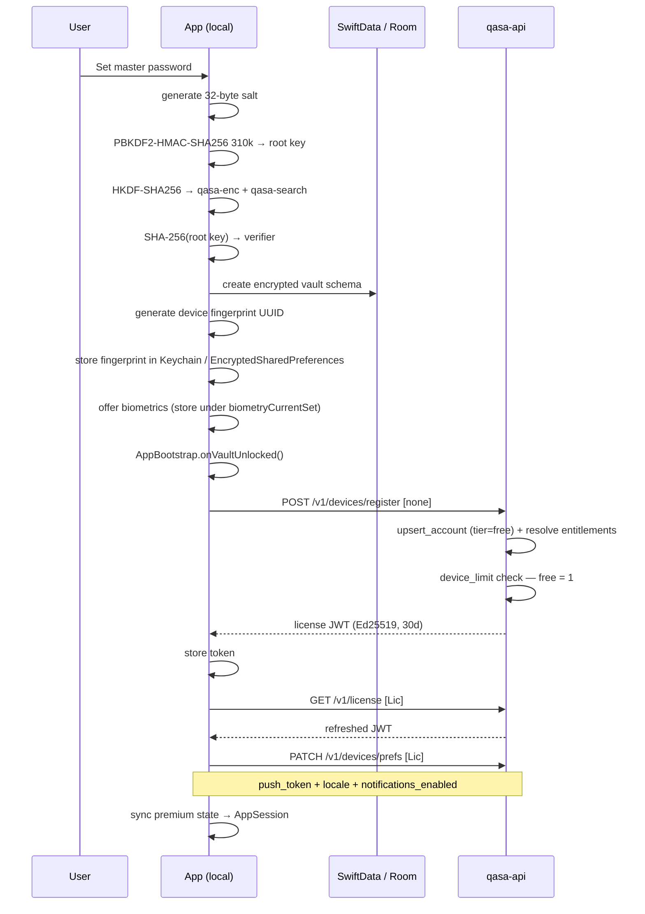

Server never sees the password, the salt, or any vault row. The first request is `/v1/devices/register` and it carries only a UUID the client invented.

Registration rejects an `expired` account up front — `devices.rs:74`. A free account that has hit its 1-device limit gets a 403 carrying `devices_used`, `device_limit`, and a device list so the UI can name the device to unlink.

---

## 2. Unlock and autolock

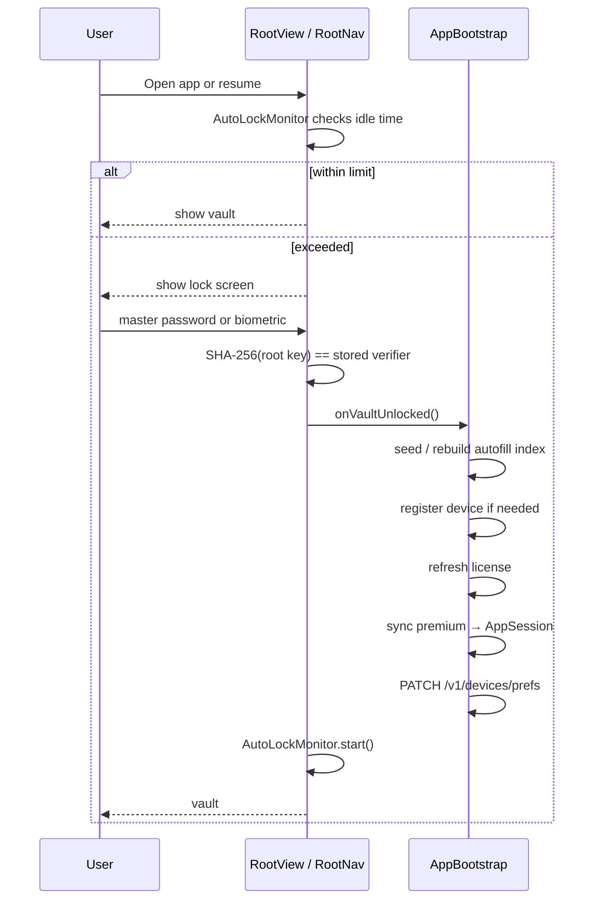

Failure mode: wrong password only ever fails the verifier comparison. There is no server-side credential to fall back to and no reset path — the vault is unrecoverable by design.

---

## 3. Vault use — free tier, zero network

Adding, editing, and reading items is entirely local. The only server calls in this flow are the ones a premium feature needs.

| Action | Local work | Server |
| --- | --- | --- |
| Create item | encrypt envelope + payload, index search tokens | none |
| List items | decrypt envelopes only | none |
| Search | hash query with `qasa-search`, match `vault_search_tokens` | none |
| Open item | decrypt payload | none |
| Autofill | read app-group index, decrypt selected entry | none |
| Change master password | `reencryptAll` — re-wrap every item, rebuild every token | none |

Listing never decrypts a full payload. Search never sees plaintext. Neither is possible to express server-side because no endpoint accepts vault content.

---

## 4. Pairing a second device

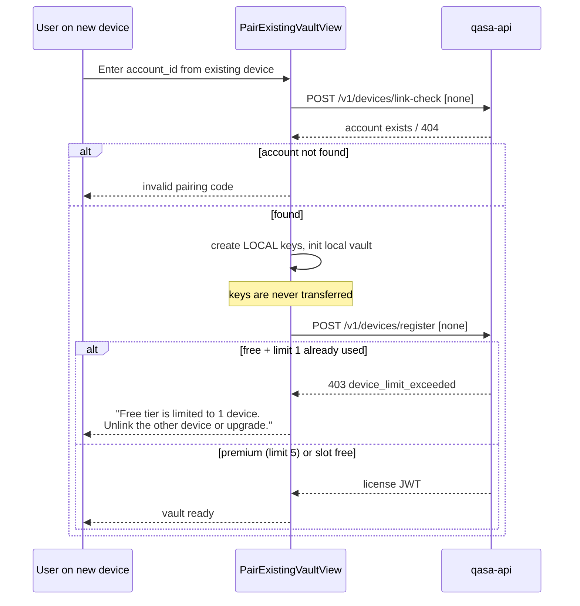

`link-check` is unauthenticated — the security property is that `account_id` is an unguessable client-generated UUID, not that a credential guards it. Nothing is created by the probe.

Critically, pairing does not move key material. The new device derives its own keys from a locally entered master password. The server coordinates membership; it never brokers secrets.

---

## 5. Upgrade to premium

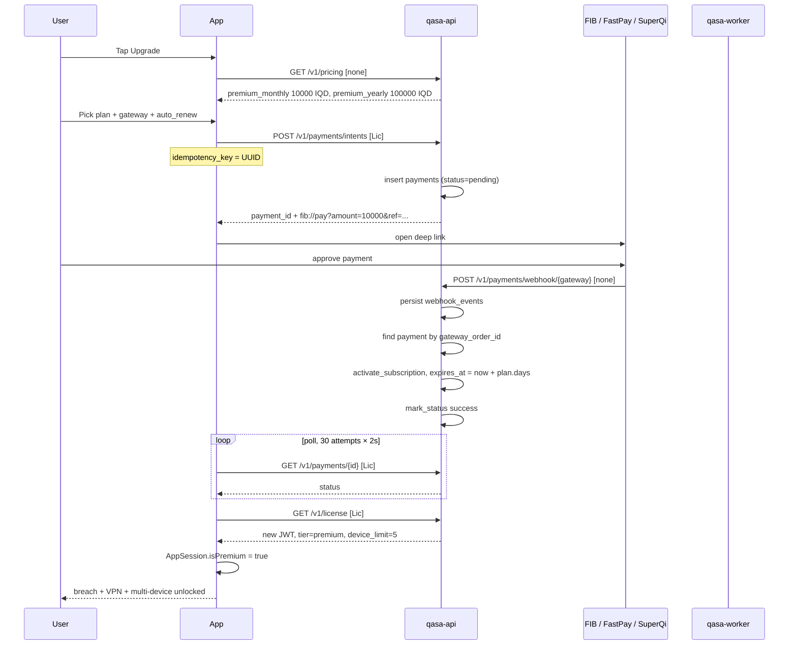

Webhook handling is idempotent — `payments.rs:130` early-returns if the payment is already `success`, so a gateway retry is harmless.

If the payment fails and the account has an auto-renew subscription, the webhook path pushes `SUB_RENEW_FAILED` immediately rather than waiting for the hourly worker.

**Simulated path** — no money, no gateway app:

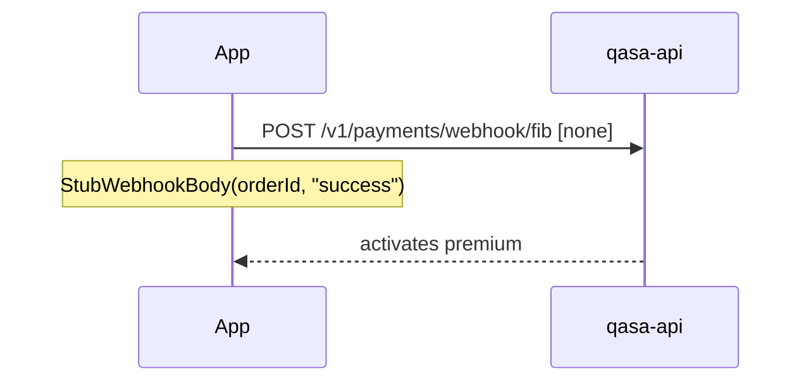

Dev-only convenience. The stub gateways accept unsigned webhooks, so they settle payments only when `QASA_ENV=dev`; in production they refuse, and `create_intent` refuses up front (see `ARCHITECTURE.md` §4.8).

---

## 6. Subscription lifecycle

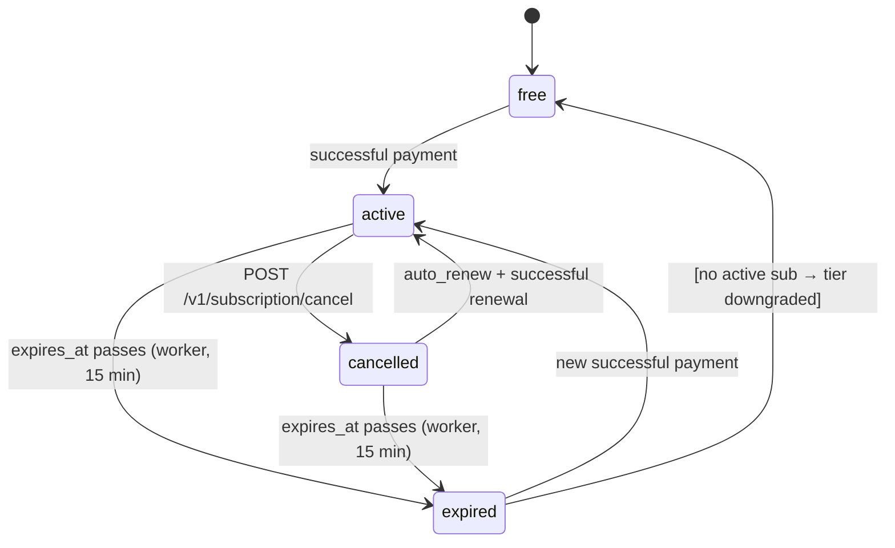

`cancelled` still grants Premium until `expires_at` — a user who paid for the month keeps access. `require_active_premium` accepts `status IN ('active','cancelled') AND expires_at > now()`.

`effective_tier` never trusts `accounts.tier` alone: a `premium` flag with no live subscription row downgrades to `expired` — `entitlements.rs:37`.

### Expiry timeline

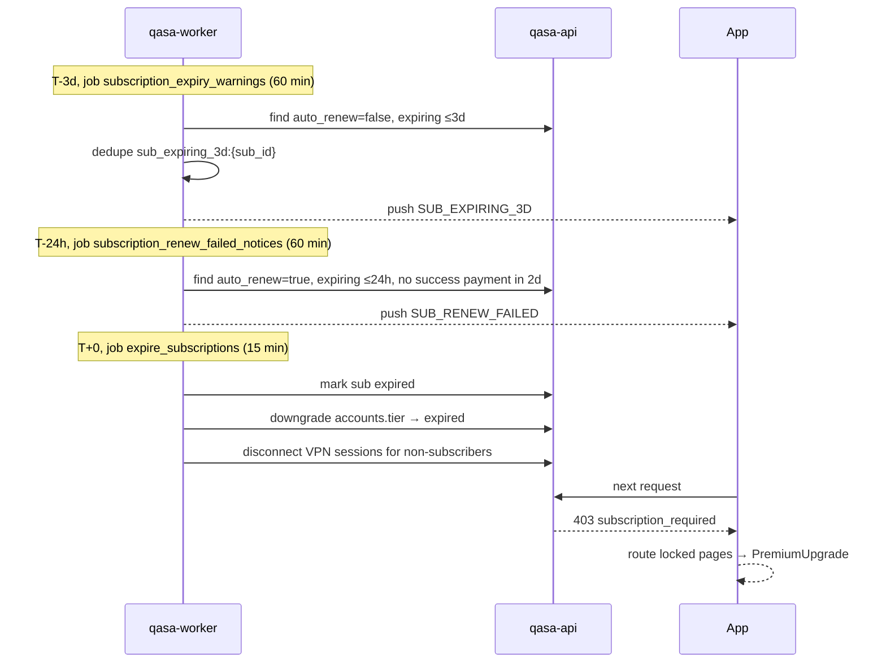

`GET /v1/vpn/status` also force-disconnects any session whose subscription has lapsed, so a stale tunnel does not outlive the sub even between worker ticks.

---

## 7. Breach monitoring — premium

k-anonymity. The server learns a 5-char prefix; the client compares the remaining 59 locally. Raw emails never leave the device.

### One-off check

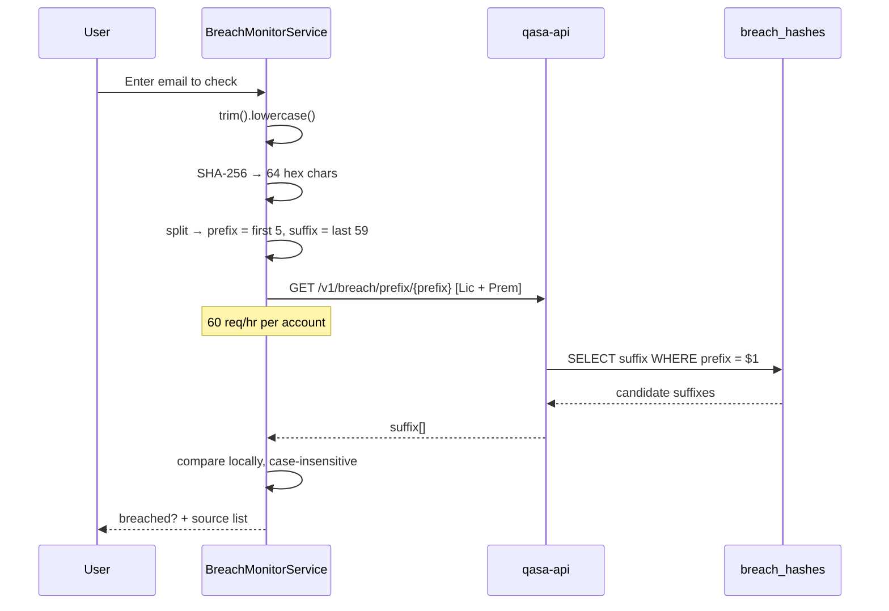

Free tier gets 403 at this endpoint. Registration itself is also Premium-gated with a limit of 10 monitored addresses.

### Ongoing monitoring

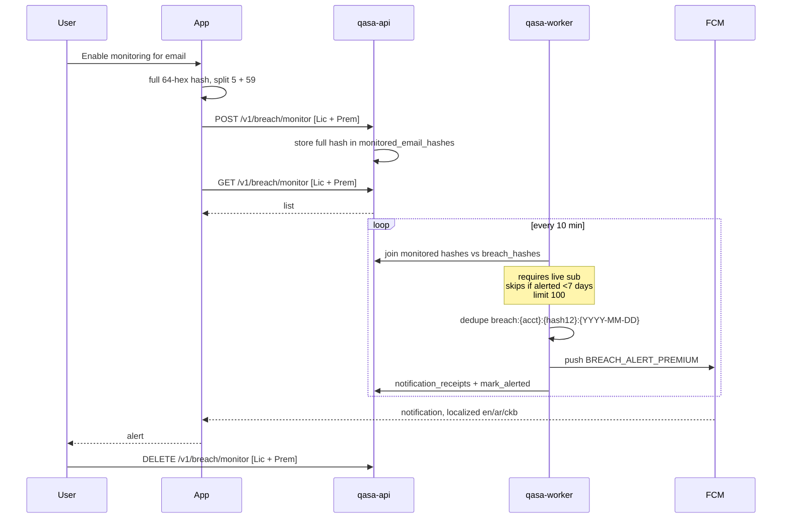

Corpus is imported offline, never fetched at runtime:

```bash
cargo run -p qasa-breach -- ingest --file <path> --source hibp-2024
cargo run -p qasa-breach -- stats
```

---

## 8. VPN — premium

Control-plane flow only. The server allocates and tracks; the node agents run the data plane.

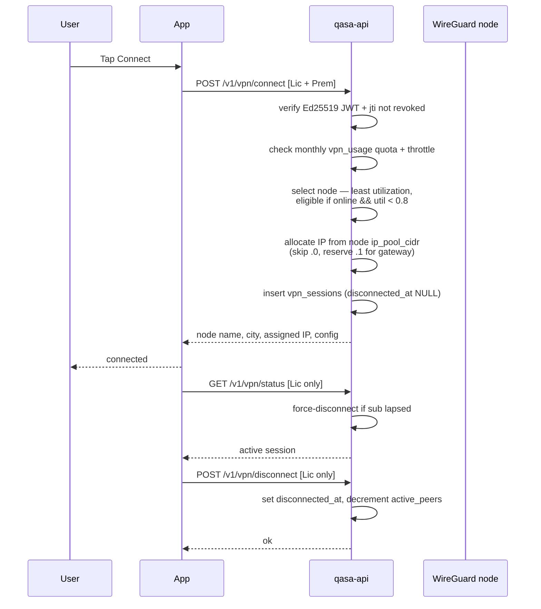

Node heartbeat is a separate path with its own auth:

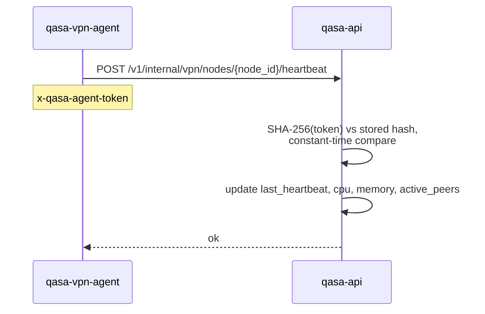

`disconnect` and `status` intentionally skip the Premium gate so a lapsed user is never stuck with a session they cannot close.

**The app does not establish a tunnel.** No `VpnService`, no `NetworkExtension`, no WireGuard library on either client. Traffic is not actually protected by this flow.

---

## 9. Autofill

### iOS — full implementation

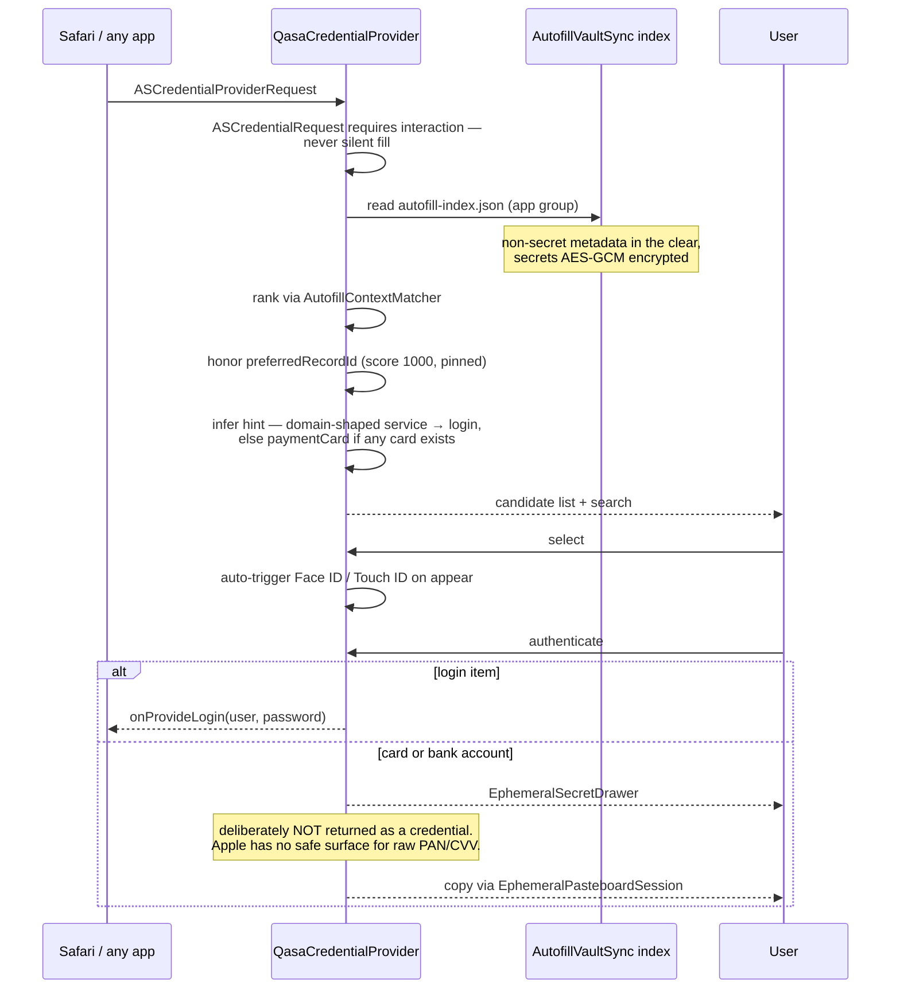

Refusing to return cards as `ASPasswordCredential` is correct and deliberate. It is the one design choice in the codebase that has no Android equivalent and should not be "fixed" on Android.

`AutofillIdentitySync` also publishes to `ASCredentialIdentityStore` so entries appear in the system password manager picker.

### Android — narrower

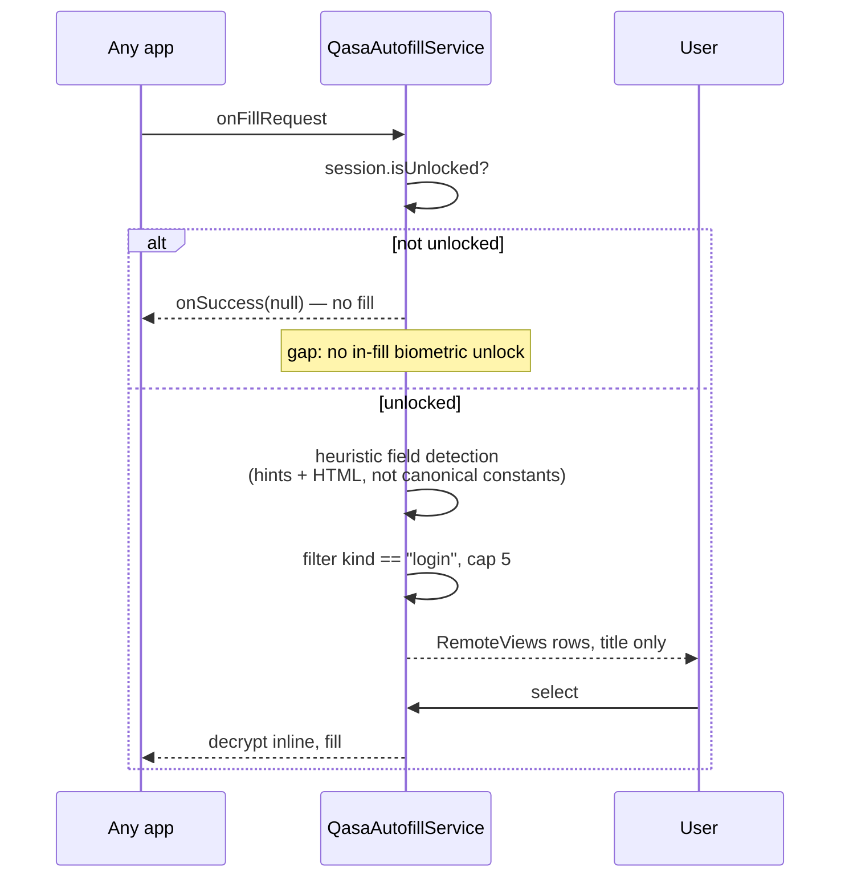

Credential Manager provider (`QasaCredentialProviderService`) is weaker still: cap 10, all entries share one generic `PendingIntent` to MainActivity so selection does not convey which credential, username displayed is `entry.title`, `onBeginCreateCredentialRequest` returns empty, `onClearCredentialStateRequest` is a no-op.

---

## 10. LAN sync

### iOS — implemented

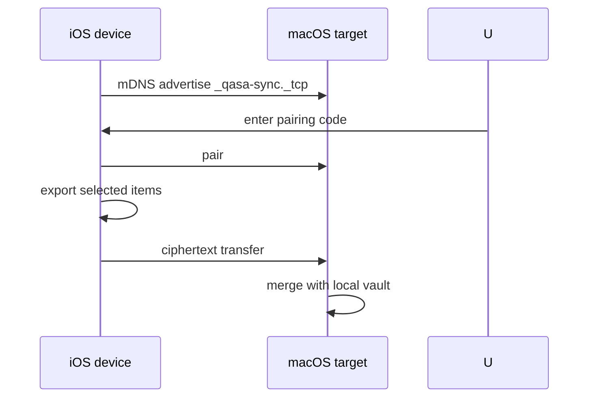

### Android — stub

`sync/LANVaultSyncService.kt` updates a status string and never opens a socket. Cross-device vault sync is iOS-only today.

---

## 11. Notifications

Two channels. In-app inbox is server-backed and durable. Push is best-effort.

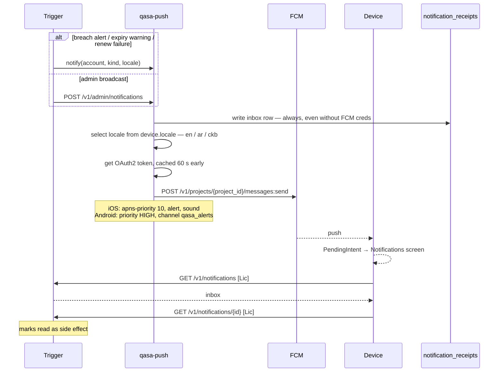

Without Firebase credentials the inbox row still writes and the push is logged — no user-visible failure.

Token upload is coupled to vault unlock (`AppBootstrap.syncLocaleToServer` PATCHes `/v1/devices/prefs` on unlock), so an FCM refresh that lands while the app is locked is not uploaded until the next unlock. A stale token can delay a breach alert.

---

## 12. Admin

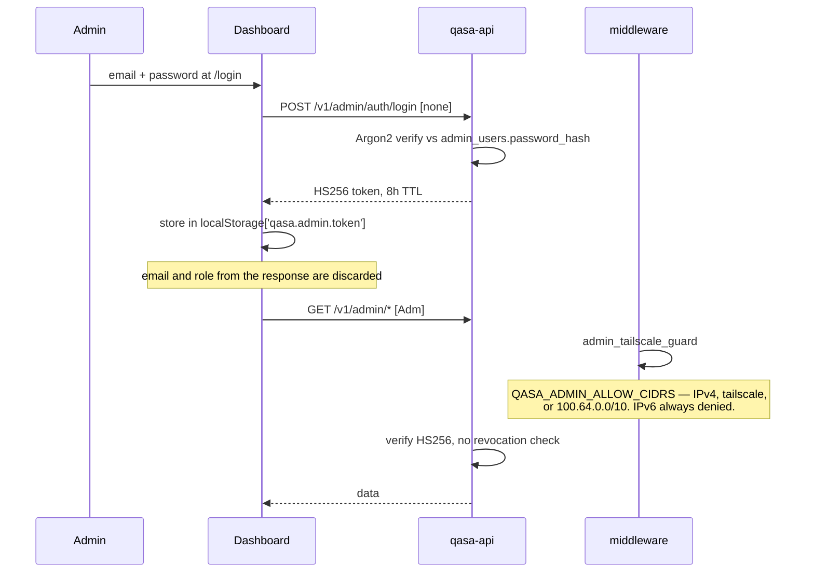

### Reads

`/v1/admin/overview`, `/analytics`, `/users`, `/payments`, `/cancellations`, `/webhooks`, `/vpn/nodes`, `/telemetry`, `/plans`, `/notifications`. Ten screens of visibility, one of which — Payments — synthesizes its JSON payload client-side from table fields rather than showing the real stored webhook body.

### Writes — only two exist

```mermaid
sequenceDiagram
    participant A as Admin
    participant D as Dashboard
    participant S as qasa-api

    rect rgb(240,248,255)
    A->>D: edit title, amount, days, VPN quota on /plans
    D->>S: PUT /v1/admin/plans  [Adm]
    S->>S: upsert
    opt notify_subscribers checked
        S-->>A: push to affected accounts
    end
    end

    rect rgb(240,248,255)
    A->>D: compose EN + optional CKB/AR on /notifications
    D->>S: POST /v1/admin/notifications  [Adm]
    Note over D: audience hardcoded 'all' — no picker
    S->>S: insert notification + fan out receipts
    S-->>A: push when FCM configured
    end
    end
```

### UI actions with no server effect

Block user, refresh session, view devices, add VPN node, and all three CSV exports are toast-only. Sign out navigates to `/login` but never clears the token, so it survives in localStorage.

---

## 13. Backend background loop

Not user-initiated, but it governs the lifecycle every other flow depends on.

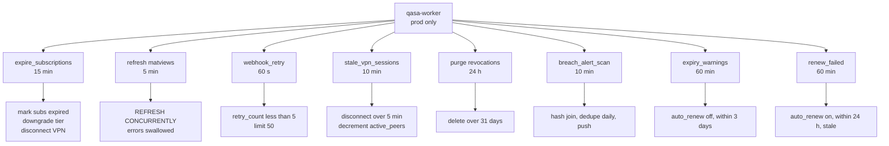

All eight loop forever. Errors are logged, never fatal. `std::future::pending()` holds the process open after spawn.

---

## 14. Cross-platform parity

| Capability | iOS | Android |
| --- | --- | --- |
| Vault storage | SwiftData, AES-GCM envelope+payload | Room `vault_items`, same scheme |
| KDF | PBKDF2-HMAC-SHA256 310k → HKDF | identical |
| Blind-index search | `VaultSearchToken` | Room `vault_search_tokens` |
| Device register / link-check | yes | yes |
| Device-limit 403 body | `DeviceLimitErrorBody` | `QasaApiException.DeviceLimitExceeded` |
| Endpoint set | 18 routes | same 18, one-to-one |
| Autofill unlock in-fill | Face ID / Touch ID | **requires app already unlocked** |
| Credential Manager / identity store | `ASCredentialIdentityStore` | provider present, weak |
| Card fill safety | ephemeral drawer, never a credential | no equivalent |
| LAN sync | Network.framework, real | **stub** |
| Notifications | categories incl. payment drawer | single `qasa_default` channel |
| Locale propagation | writes `AppleLanguages` to app group too | Room + resources |
| Autolock | scene phase + gesture | 15 s poll |

The API contract has no drift. Every divergence is client-side capability, not protocol.
